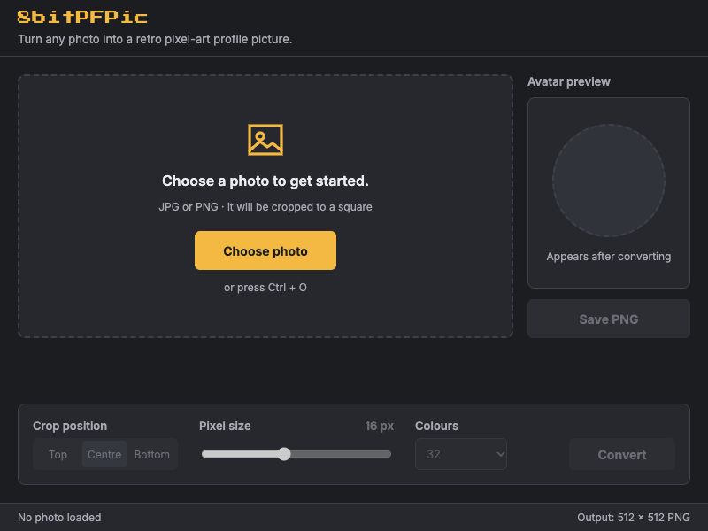
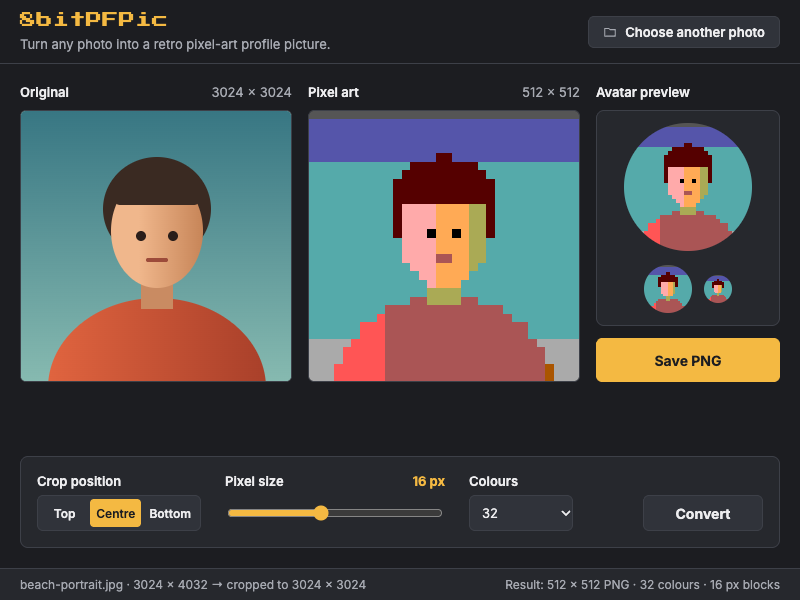

# bitPFPic

App for turning photos into pixel-art profile pictures.

Choose a photo, adjust the pixel size and colour count, preview the result, and save the PNG.

## Status

Planning, early AI drafting, consultation, and experimentation. The features below describe the intended app, not a finished release.

## Why I’m building this

I wanted a pixel-art profile picture that still looked like me.

GitHub’s [identicons](https://github.com/leviathanbadger/identicon) inspired the geometric style, but generate patterns from text. Photo converters like [img8bit](https://img8bit.com) haven’t consistently produced the look I want.

I’m writing the MVP by hand using documentation to learn image processing, desktop interfaces, and Git. AI helps with planning, explanations, and design exploration.

## MVP1 — Basic conversion

- Open `avatar.jpg`, correct its orientation, and convert to RGB.
- Crop to a centred square and shrink to 64 × 64 using Lanczos.
- Reduce to up to 32 colours using median-cut quantization.
- Enlarge to 512 × 512 using nearest neighbour for sharp pixel edges.
- Save as `pixel-avatar.png`, leaving the original unchanged.

## MVP2 — Desktop interface

- Choose a JPG or PNG from any folder.
- Select top, centre, or bottom square cropping.
- Adjust pixel block size and choose 8, 16, 32, 64, 128, or 256 colours.
- Convert and compare the original crop with the result.
- Show a circular avatar preview.
- Save a square 512 × 512 PNG to a chosen location.
- Choose another photo and repeat.

Processing stays local, with no accounts or uploads.

### Pixel block size

Block size describes the size of each square in the final 512 × 512 image.

| Block size | Underlying pixel grid |
|------------|-----------------------|
| 4 px       | 128 × 128             |
| 8 px       | 64 × 64               |
| 16 px      | 32 × 32               |
| 32 px      | 16 × 16               |

The retro appearance comes from a small pixel grid and limited colours.
This is photo-based pixelation, rather than hand-drawn pixel art.

## Interface design

The mockup below was created with Claude Design as a visual reference.
I’ll recreate the interface in Python; it is not a screenshot of a working app.

The empty state shows a Choose photo button and disabled controls.
The editing state shows original/result previews, a circular avatar preview,
conversion settings, Save PNG, and file details.

Changing settings requires another conversion before saving.
The circular preview is only a viewing aid; the exported image stays square.

## Technology

- Python for application logic.
- Pillow for image processing and PNG export.
- Tkinter / CustomTkinter for the desktop interface.
- Git and GitHub for version history.

## Development checklist

### Setup

- [x] Create the bitPFPic GitHub repository.
- [x] Add this README.
- [x] Add the custom LICENSE.
- [x] Add a Python .gitignore.
- [ ] Clone into a separate project folder.
- [ ] Create a virtual environment and confirm Tkinter works.
- [ ] Install dependencies and record them in requirements.txt.
- [ ] Configure VS Code to use the project environment.
- [ ] Save the Claude Design mockup in docs/design/ui-reference.png.
- [ ] Start the development journal.

### MVP1

- [ ] Build and understand the conversion steps above.
- [ ] Keep conversion in a function separate from the interface.
- [ ] Convert one photo successfully without a GUI.

### MVP2

- [ ] Build the window and photo picker.
- [ ] Display the original and converted images.
- [ ] Add crop, pixel-size, and colour controls.
- [ ] Add PNG saving and handle cancelled dialogs.
- [ ] Enable buttons only when their actions are valid.
- [ ] Recreate the design, including the circular preview.
- [ ] Reset state correctly when another photo is selected.

### Check and release

- [ ] Try different photo shapes, orientations, lighting, and backgrounds.
- [ ] Handle unreadable files and paths containing spaces.
- [ ] Check facial resemblance and sharp preview edges.
- [ ] Confirm exports match the result and originals stay unchanged.
- [ ] Check the layout when resizing the window.
- [ ] Verify setup in a fresh environment.
- [ ] Add instructions, app screenshots, examples, credits, and limitations.
- [ ] Publish the first MVP release.

## Development journal

I’ll record my process in [docs/development.md](docs/development.md):
what I tried, what worked, problems encountered, decisions, and lessons learned.

Entries will also describe how I used AI assistance and what I implemented
or adapted myself. Commit messages will record individual code changes.

## Project structure

    bitPFPic/
    ├── bitPFPic.py
    ├── README.md
    ├── LICENSE
    ├── .gitignore
    ├── docs/
        ├── development.md
        └── ui-reference1.png
        └── ui-reference2.png

- app.py: start with one source file; split it only when useful.
- docs : UI mockups and visual references.
- docs/development.md: development journal.

Keep personal photos, generated test images, and the virtual environment
out of Git unless deliberately included as examples.

## Later ideas

Retro palettes, dithering, brightness/contrast, interactive cropping,
background controls, other output sizes, batch conversion, optional
pixel accessories, animated GIFs, and a packaged desktop app.

## References

- [Pillow Image](https://pillow.readthedocs.io/en/stable/reference/Image.html)
- [ImageOps](https://pillow.readthedocs.io/en/stable/reference/ImageOps.html)
- [ImageTk](https://pillow.readthedocs.io/en/stable/reference/ImageTk.html)
- [Tkinter](https://docs.python.org/3/library/tkinter.html)
- [CustomTkinter](https://customtkinter.tomschimansky.com/documentation/)
- [Identicon](https://github.com/leviathanbadger/identicon)
- [PAC](https://github.com/Hexanol777/PAC-Pixel-Art-Converter)
- [Pixel It](https://github.com/giventofly/pixelit)

Any reused code must follow its original license and retain required notices.

## License

Source-available under the custom [No-Sale License](LICENSE).
Use, modification, and free sharing are allowed; selling original or
modified copies, including in paid software bundles, is prohibited.
Images created with the app are not restricted by this software license.

See LICENSE for the governing terms.
